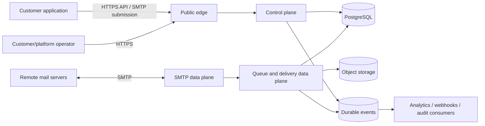

# Architecture overview

## Decision summary

Use a **small number of independently scalable deployables with modular boundaries**, not a fleet of fine-grained microservices:

1. **Control plane** — Go API and administrative components.
2. **SMTP ingress/data plane** — Rust submission and optional inbound protocol processes.
3. **Queue and delivery data plane** — Rust durable queue workers and outbound SMTP transport.
4. **Dashboard** — Next.js client, never on the delivery critical path.
5. **Shared infrastructure** — PostgreSQL, object storage when required, cache only where justified, secret/KMS, and telemetry.

The control plane authorizes and configures the data plane but is not synchronously called for every accepted message or delivery attempt. Data-plane workers use signed/versioned configuration snapshots and locally cached policy leases. Revocations and emergency suspensions propagate through a durable control event and bounded polling; an expired policy lease fails closed for new acceptance, while already accepted messages follow documented abuse and legal-hold rules.

## Context

## Responsibility split

| Plane           | Owns                                                                                                | Must not own                                                       |
| --------------- | --------------------------------------------------------------------------------------------------- | ------------------------------------------------------------------ |
| Control         | tenant configuration, identities, domains, credentials, policy, quotas, billing references, audit   | per-message SMTP dialogue, delivery retries, raw message streaming |
| Data            | protocol sessions, validation, durable acceptance, queue scheduling, SMTP delivery, bounce outcomes | tenant administration, billing, interactive dashboards             |
| Shared platform | transactional persistence, durable event transport, secrets, keys, telemetry                        | business authorization decisions without an owning service         |

## Critical invariants

1. A successful SMTP `250` or API acceptance is returned only after the authoritative message record and required content reference are durably committed.
2. Queue publication and object storage are not assumed atomic; the acceptance record/outbox is the recovery authority.
3. Internal processing is at least once. State transitions and event consumers are idempotent.
4. A remote SMTP `2xx` means acceptance by the next SMTP server, not inbox placement or human readership.
5. No unauthenticated path is an open relay.
6. Tenant identity comes from authenticated context, never a caller-selected tenant field.
7. Analytics, billing, webhooks, and dashboards cannot block durable acceptance or SMTP delivery.
8. Message bodies, credentials, tokens, and unnecessary personal data are excluded from ordinary logs and events.

## Alternatives

| Option                              | Assessment                                                                                                                                                                     |
| ----------------------------------- | ------------------------------------------------------------------------------------------------------------------------------------------------------------------------------ |
| Modular monolith                    | Lowest operational cost and good first milestone; protocol and delivery failure domains remain too coupled for a public production service.                                    |
| Selected small-service architecture | Separates protocol, delivery, and administration while preserving local transactions and contributor ergonomics. **Selected.**                                                 |
| Fine-grained microservices          | Independent scaling is attractive, but creates synchronous chains, distributed transactions, and high operational cost before workload evidence exists. Rejected for Phase 01. |

The selected design can start with combined processes in development and a minimal production deployment, then split only when throughput, security, or failure isolation justifies it.
