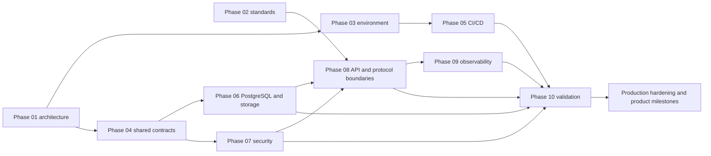

# Phase 01–10 integration and completion

This document reviews how the outputs of Phases 01–10 connect to one another.
It is the integration companion to the [phase implementation
status](phase-status.md) register and the [Phase 10 validation
reports](validation/README.md).

## Completion statement

Phases 01–10 are complete for their documented foundation and validation
scope. The repository has an integrated local development and validation
foundation, not a production-ready hosted SMTP platform. “Complete” means that
the phase deliverables, boundaries, tests, and deferred-work decisions are
recorded; it does not mean that every future product capability is implemented.

## Connected architecture

## Phase handoff matrix

| Phase | Delivered output | Current integration | Status |
|---|---|---|---|
| 01 Architecture | Service boundaries, lifecycle, PostgreSQL-first durability, security boundaries, extension paths | Governs Rust data-plane services, Go control plane, dashboard, storage, and later validation | **Integrated** |
| 02 Standards | RFC/IANA requirements, protocol traceability, conformance plan | Constrains SMTP/MIME, DNS, TLS, authentication, and future delivery features | **Integrated as requirements; protocol conformance remains incomplete** |
| 03 Environment | Toolchain, Make workflow, Compose PostgreSQL, bootstrap/runner scripts | Supplies reproducible local setup for Rust, Go, dashboard, migrations, and checks | **Integrated locally** |
| 04 Core infrastructure | Configuration, secrets interfaces, IDs, errors, events, logging, shutdown, database foundation | Used by Rust services and shared contracts; Go API has parallel standard-library boundaries | **Integrated locally; production adapters deferred** |
| 05 CI/CD | Rust/Go/dashboard checks, migration/queue checks, security scanning, release checks | Automates the validation commands and exposes unresolved dependency findings | **Integrated in repository; remote governance and artifact hardening remain** |
| 06 Storage | Migrations, queue schema, control-plane/inbound schema, pools, backup/restore | Queue and inbound persistence are exercised against PostgreSQL; control-plane schema exists | **Partially integrated** |
| 07 Security | Typed identities, default-deny authorization, tenant checks, API-key validation, audit foundations | Enforced by Go API handlers and covered by security/control-plane tests | **Integrated for development/API boundary; production identity remains** |
| 08 API | `/v1` HTTP boundary, request IDs, strict JSON, pagination, errors, OpenAPI | Connects clients to the Go control plane and security middleware | **Integrated; durable repositories and send API remain** |
| 09 Observability | Structured logs, process-local metrics, health endpoints, dashboard/alerts | Live API exposes health and Prometheus text; Rust tracing remains local | **Integrated locally; centralized telemetry remains** |
| 10 Validation | Cross-component tests, migration/queue/backup/restore evidence, performance smoke test, risk register | Validates the currently connected foundation and records blockers | **Validated with limitations** |

## Currently connected end-to-end paths

### Local development path

`bootstrap-dev.sh` and Make targets establish the pinned Rust/Go/dashboard
tooling and start PostgreSQL through Compose. Configuration is validated before
services run. The API, dashboard, SMTP ingress, and queue worker can be started
through the documented development runner.

### SMTP queue path

The bounded Rust SMTP session accepts a message only at its configured
acceptance boundary. With the database configured, the queue persists
idempotent work, leases claims, tracks attempts, and applies bounded retry
behavior. The delivery worker can process queue work when explicitly enabled;
external delivery remains disabled by default and is not mailbox-placement
proof.

### Inbound persistence path

The opt-in inbound acceptor routes only to active mailboxes on verified domains
and persists routing metadata plus the raw message in one PostgreSQL
transaction before returning SMTP `250`. This is separate from outbound queue
processing.

### Control-plane security path

The `/v1` Go API applies request-ID and strict-input handling, authenticates
development/API-key principals, applies default-deny permissions and tenant
resource checks, and returns the documented error envelope. The path is covered
by Go tests and race tests. The current store is in memory, so this path is not
yet suitable for multi-instance production operation.

### Operational visibility path

The API exposes separate liveness/readiness handlers, Prometheus-compatible
process-local metrics, and structured request-completion logs. Phase 10
verified these endpoints live. No centralized collector, durable metrics
storage, alert routing, or cross-service trace backend is connected yet.

### Recovery path

Phase 06 backup tooling was exercised by Phase 10 against disposable
PostgreSQL. The dump was listed and restored into a separate database, where
the expected schema was verified. This validates the local procedure, not
encrypted off-site backups, production access review, or disaster recovery
objectives.

## Integration gaps requiring future work

These are intentional handoff gaps, not undocumented failures:

1. **Control plane → PostgreSQL:** Replace the in-memory Go store with durable
   repositories for tenants, domains, API keys, audit events, quotas, and
   delivery read models.
2. **API → durable queue:** Implement the authenticated send API and connect it
   to queue enqueue/idempotency and sender-domain authorization.
3. **Security → production identity/secrets:** Add OIDC, workload identity or
   mTLS, secret manager/KMS, certificate management, rotation, and durable
   credential verification.
4. **Core events → durable delivery:** Add an outbox/publisher, consumers,
   retries, dead-letter handling, and correlation propagation once real
   event-producing workflows exist.
5. **API/data plane → distributed communication:** Add an authenticated
   service client only when a second service has a real request/response
   consumer; do not add an unused RPC layer.
6. **Observability → deployment:** Connect centralized logs, metrics, traces,
   dashboards, and alert notifications after a production runtime is chosen.
7. **CI/CD → release environment:** Add image scanning, SBOM/provenance,
   protected branches, promotion, rollback, and environment-specific secrets.
8. **Standards → delivery compliance:** Implement DKIM, submission
   authentication, bounce/DSN processing, suppression, reputation controls,
   and selected interoperability profiles.

## Readiness boundary

The Phase 10 decision is **Validated With Limitations**. The foundation is
ready for continued product development and controlled local/integration
testing. It is not ready for public production email traffic until the
high-risk items in the [risk register](validation/risk-register.md) and the
release blockers in the [readiness assessment](validation/release-readiness.md)
are addressed or explicitly accepted through a time-bounded launch decision.

## Maintenance rule

When a deferred handoff is implemented, update this document, the relevant
phase section in [phase-status.md](phase-status.md), the affected architecture
decision record, and the Phase 10 evidence matrix. A passing unit test or
documented interface alone must not be changed to **Integrated** without
cross-component evidence.
